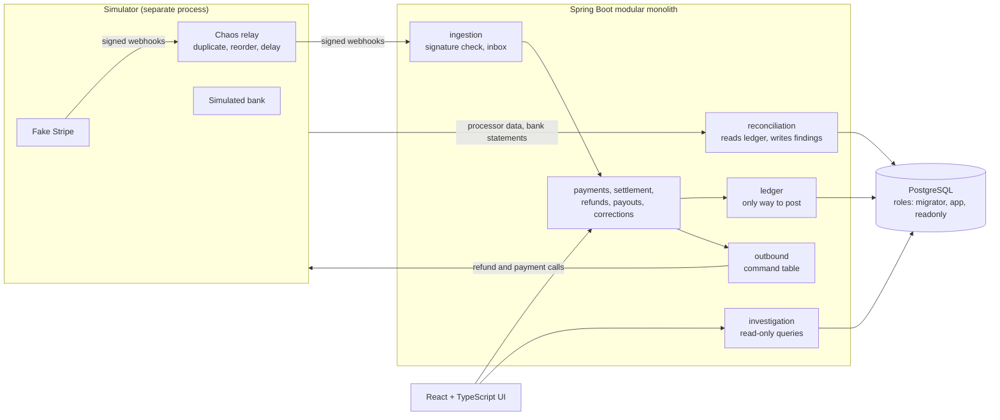

# LedgerLab

A payment settlement and reconciliation sandbox: signed processor webhooks, refunds and payouts recorded on an append-only double-entry ledger in PostgreSQL, then reconciled against processor and bank records.

**[See the demo](docs/demo.md)** · **[Read the architecture](docs/architecture.md)** · **[Reproduce the tests](#reproduce-the-tests)**

> **Sandbox only.** All merchants, payments and statements are synthetic or come from Stripe test mode. LedgerLab handles no real money, customers or payment credentials, and it isn't deployed anywhere.

## What it shows

- **Retries are safe.** Repeated webhooks and API calls have no second effect, through three separate idempotency layers.
- **Concurrent money movement can't overspend.** Two CAD 60 refunds against CAD 100 give one success and one rejection, enforced with row locks inside a transaction.
- **An unknown outcome stays unknown.** If the bank's response is lost, the payout stays reserved until a query or the bank statement settles it. Cash moves only on statement evidence.
- **History can't be edited.** Entries are sealed by database triggers and role grants. Corrections are reversals plus restatements, limited to named types.
- **Reconciliation is independent.** Discrepancies are checked against seeded fixtures that the ledger under test doesn't produce, and every finding links to its evidence.

Built with Java 25, Spring Boot 4.1, Spring Modulith, PostgreSQL, Flyway, React, TypeScript, Testcontainers, jqwik, Playwright, Prometheus and GitHub Actions, plus standard-library Python for the investigation agent.

## Architecture



Details, the money model and the design trade-offs are in the [architecture overview](docs/architecture.md).

## Status

| Phase | Scope | State | Where |
|---|---|---|---|
| P1–P4 | Ledger, webhook intake, settlement, bank reconciliation, refunds, corrections | Done | `main` |
| P5 | Merchant payouts with unknown-outcome recovery | Done | `main` |
| P6 | Real Stripe test mode | Done: real webhooks, missed-event recovery, real automatic payout as a batch, refunds through Stripe and reconciliation on live data all pass ([checklist](docs/handoff/p6.md), [run report](docs/runs/sandbox-sbx_20261102T224453022706Z.md)) | `main` |
| P7 | Public break-it demo page, runtime invariants, performance baseline, AWS plan | Done locally; not deployed ([checklist](docs/handoff/p7.md)) | `main` |
| P8 | Read-only investigation agent with a rule baseline and a frozen evaluation | Done: on the held-out hard set DeepSeek answers 43 of 46, the rule baseline 14 ([checklist](docs/handoff/p8.md), [report](docs/eval/agent-2026-11-07.md)) | `main` |
| P9 | Agent in the reconciliation workbench (human adopts) and a read-only MCP server | Done ([checklist](docs/handoff/p9.md)) | `main` |
| P10 | Structured JSON logs, Prometheus metrics on a loopback management port, an inbox-stuck alert, deploy plan with observability | Done; no cloud resources ([checklist](docs/handoff/p10.md)) | `main` |
| P11 | Three more alerts, delivery through Alertmanager to a local receiver, a tracing plan (not built) | Done ([checklist](docs/handoff/p11.md)) | `main` |

The `investigation` module on `main` is read-only query APIs; the AI agent that calls them lives in `agent/`.

Two limits to keep in mind. The fake Stripe implements only the subset this project uses, and real Stripe is the authority where they differ; recorded, redacted Stripe test-mode fixtures drive contract tests that catch differences (`src/test/resources/contracts/stripe-sandbox/`). In Stripe test mode, webhooks and settlement data both come from Stripe, so they are less independent of each other than the simulator's fixtures, and reconciliation accuracy can only be judged in simulator mode, where the true answer is known.

## Reproduce the tests

You need JDK 25, Docker with Compose v2, Node 24, Python 3.12+ and a POSIX shell (Git Bash on Windows). No Stripe account is needed, and nothing here reads `.env` except the optional local database at the end.

```sh
./mvnw verify                          # main app, on Testcontainers PostgreSQL
./mvnw -f simulator/pom.xml verify     # fake Stripe, chaos relay, simulated bank
cd frontend
npm ci
npm run check                          # lint, types, unit tests
npx playwright install chromium
npm run test:e2e                       # browser tests against the real backend
cd ..
sh scripts/smoke-p4.sh                 # app + simulator + PostgreSQL: includes P2 and P3
sh scripts/smoke-p5.sh                 # the same, for payouts
./mvnw -Pmodel test -Dtest=PaymentModelProperties,RefundStatefulProperties   # 1000 sequences each, slow
```

Last measured on 2026-11-07 from a fresh clone of `main` at `ffacd36` (after P11), on Windows 11:

| Command | Result | Time |
|---|---|---|
| `./mvnw verify` | 2001 tests, 0 failures | 55 min |
| `./mvnw -f simulator/pom.xml verify` | 256 tests, 0 failures | a few minutes |
| `npm run check` | 50 tests, 0 failures | under 1 min |
| `npm run test:e2e` | 10 scenarios, 23 tests, 0 failures | about 6 min |
| `smoke-p2`, `smoke-p3`, `smoke-p4`, `smoke-p5` | All pass | 1–4 min each |
| `sh scripts/demo/check-reset.sh` | Pass | a few minutes |
| Python: `agent/tests`, `agent/service/tests`, `agent/mcp/tests`, `scripts/ops/tests`, `eval.sh --check` | 316, 36, 20 and 12 tests pass; evaluation unchanged | about 1 min |

Model tests weren't part of that local run; on `main` at `ffacd36` they passed in [GitHub Actions](https://github.com/itsChihyeh/LedgerLab/actions/workflows/ci.yml) (1000 sequences each). They use fixed seeds, so a rerun replays the same sequences.

CI also runs PIT mutation testing on the `ledger` module only (133 mutations, 113 killed, 85%, at `fdc94b5`).

How the smoke scripts work: [smoke walkthrough](docs/testing/smoke-walkthrough.md) (Chinese).

To start only a local PostgreSQL with the database roles, run `cp .env.example .env`, fill in the passwords, then `docker compose up -d`.

## Real Stripe test mode (optional)

The same adapter also runs against a real Stripe test-mode account, as a long-running local stack. It is not part of CI, which only replays the recorded, redacted fixtures. You need a Stripe CLI `stripe login` and a restricted test key in your local `.env` (never committed; loaded by `scripts/sandbox/env.sh`). Live keys and `livemode=true` events are rejected.

```sh
sh scripts/sandbox/up.sh                      # stack + real webhooks via stripe listen and the chaos relay
sh scripts/sandbox/traffic.sh --count 20 --card pm_card_bypassPending --seed 1
sh scripts/sandbox/catchup.sh                 # resend missed events, sync and import the bank
sh scripts/sandbox/accept.sh --only ac-8.4    # also ac-8.5 / ac-8.6 / ac-8.8 / ac-8.9
sh scripts/sandbox/check-payout.sh            # exit 0 once an automatic payout has settled, 75 while waiting
sh scripts/sandbox/report.sh                  # write the run report under docs/runs/
sh scripts/sandbox/down.sh                    # stop; keeps volumes
```

Any figures about the real run (payments, refunds, the payout, duplicates and invariants) come from the [run report](docs/runs/sandbox-sbx_20261102T224453022706Z.md) only.

## Break-it demo, performance baseline (local)

```sh
sh scripts/demo/up.sh            # fake Stripe + simulated bank on 127.0.0.1:28080: build, start, seed, check all invariants
sh scripts/demo/status.sh
sh scripts/demo/reset.sh         # the daily reset: archive today's summary, then rebuild and reseed
sh scripts/demo/down.sh          # remove the stack and its volumes
sh scripts/demo/check-reset.sh   # up, actions, reset, assertions, down; evidence in target/demo/
cd frontend && npm run video:demo   # scripted demo video into docs/media/
sh perf/run.sh                   # k6 baseline on its own stack, about an hour; see docs/perf/baseline-2026-11-05.md
```

The AWS deployment plan (not executed, no cloud resources) is in [docs/deploy/aws-plan.md](docs/deploy/aws-plan.md).

## Investigation agent (P8)

A read-only agent that investigates one reconciliation issue: it calls a fixed set of GET-only tools against the investigation API, then returns a validated conclusion (root cause, cited records, recommended action) or abstains when the evidence is insufficient. It cannot write anything; the read-only guarantee is checked in the tool layer, in server-side route tests and by the `readonly` database role. On a held-out "hard" set of by-product discrepancies, the rule baseline answers 14 of 46 and abstains on the rest, while DeepSeek (`deepseek-flash`) answers 43 of 46 with no wrong root cause; on the dev and test sets the two are roughly even. One full pass over all three sets cost about US$0.83; the report also lists one genuinely fabricated id and the other caveats. Standard-library Python, no network needed to try it:

```sh
sh scripts/agent/eval.sh --check   # replay the frozen dev/test/hard sets; exit 1 if a hard line fails
```

See [agent/README.md](agent/README.md), the [P8 handoff](docs/handoff/p8.md), the [evaluation report](docs/eval/agent-2026-11-07.md) and the [notes on the DeepSeek run](docs/eval/deepseek-2026-11-07-notes.md).

### In the workbench and over MCP (P9)

The issue page of the reconciliation workbench has an investigation panel: a small local service runs the agent on request, and the panel shows its conclusion with clickable citations. A person can adopt only two kinds of conclusion (a split bank deposit, a processor fee difference); adopting just opens a pre-filled form, and nothing is written until the person submits it through the existing correction or accept endpoint. The agent itself still has no write access. The same read-only tools are also offered as a stdio MCP server for other agent clients. The panel runs the local stand-in, not an external model, and says so. See the [P9 handoff](docs/handoff/p9.md) and the [design](docs/design/agent-workbench-and-mcp.md).

## Logs, metrics and alerts (P10–P11)

Set `LEDGERLAB_LOG_FORMAT=logstash` and the app writes one JSON object per line, carrying the request id and the business ids (`eventId`, `commandId`, `runId`, `issueId`). Request bodies, signatures and keys never appear in the logs. Prometheus metrics are on a separate management port bound to 127.0.0.1 (`/actuator/prometheus` on 8079), never on the public port. Four alert rules are in `ops/prometheus/alerts.yml`: the inbox is stuck, outbound commands hit their attempt limit, a reconciliation run failed, and the app's metrics are gone. Each rule is tested with `promtool`. Alertmanager sends alerts only to a local receiver, and nothing leaves the machine:

```sh
python scripts/ops/alert-sink.py --out alerts.jsonl   # writes each notification as one JSON line
```

Tests drive the inbox alert from the real app through Prometheus and Alertmanager to a receiver, firing and then resolved (`AlertDeliveryTest`). The runbook is [docs/ops/runbook.md](docs/ops/runbook.md). Distributed tracing is planned but not built: [docs/design/tracing.md](docs/design/tracing.md) (Chinese).

## Read more

- [Architecture overview](docs/architecture.md), the English entry point to the Chinese design documents
- [Money model with worked examples](docs/design/money-model.md), [acceptance criteria](docs/acceptance-criteria.md) and [decision records](docs/adr/) (Chinese)
- [How this was built](docs/ai-usage.md): most of this code was written by AI agents, and this page says who did what
- [Rules for coding agents](AGENTS.md) (Chinese)

## License

[MIT](LICENSE)
