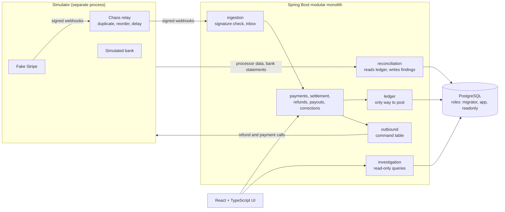

# LedgerLab

A payment settlement and reconciliation sandbox: signed processor webhooks, refunds and payouts recorded on an append-only double-entry ledger in PostgreSQL, then reconciled against processor and bank records.

**[See the demo](docs/demo.md)** · **[Read the architecture](docs/architecture.md)** · **[Reproduce the tests](#reproduce-the-tests)**

> **Sandbox only.** All merchants, payments and statements are synthetic or come from Stripe test mode. LedgerLab handles no real money, customers or payment credentials, and it isn't deployed anywhere.

## What it shows

- **Retries are safe.** Repeated webhooks and API calls have no second effect, through three separate idempotency layers.
- **Concurrent money movement can't overspend.** Two CAD 60 refunds against CAD 100 give one success and one rejection, enforced with row locks inside a transaction.
- **An unknown outcome stays unknown.** If the bank's response is lost, the payout stays reserved until a query or the bank statement settles it. Cash moves only on statement evidence.
- **History can't be edited.** Entries are sealed by database triggers and role grants. Corrections are reversals plus restatements, limited to named types.
- **Reconciliation is independent.** Discrepancies are checked against seeded fixtures that the ledger under test doesn't produce, and every finding links to its evidence.

Built with Java 25, Spring Boot 4.1, Spring Modulith, PostgreSQL, Flyway, React, TypeScript, Testcontainers, jqwik, Playwright and GitHub Actions.

## Architecture



Details, the money model and the design trade-offs are in the [architecture overview](docs/architecture.md).

## Status

| Phase | Scope | State | Where |
|---|---|---|---|
| P1–P4 | Ledger, webhook intake, settlement, bank reconciliation, refunds, corrections | Done | `main` |
| P5 | Merchant payouts with unknown-outcome recovery | Done | `main` |
| P6 | Real Stripe test mode | In progress: real webhook intake and missed-event recovery pass; real payouts, refunds and reconciliation are waiting on Stripe's first automatic payout | [`p6`](https://github.com/itsChihyeh/LedgerLab/tree/p6) |
| P7 | Deployment, public demo page, performance baseline | Not started | |
| P8 | Read-only investigation agent | Not started | |

The `investigation` module on `main` is read-only query APIs, not an AI agent.

Two limits to keep in mind. The fake Stripe implements only the subset this project uses, and real Stripe is the authority where they differ; the contract tests that catch differences are on `p6`. In Stripe test mode, webhooks and settlement data both come from Stripe, so they are less independent of each other than the simulator's fixtures, and reconciliation accuracy can only be judged in simulator mode, where the true answer is known.

## Reproduce the tests

You need JDK 25, Docker with Compose v2, Node 24, Python 3.9+ and a POSIX shell (Git Bash on Windows). No Stripe account is needed, and nothing here reads `.env` except the optional local database at the end.

```sh
./mvnw verify                          # main app, on Testcontainers PostgreSQL
./mvnw -f simulator/pom.xml verify     # fake Stripe, chaos relay, simulated bank
cd frontend
npm ci
npm run check                          # lint, types, unit tests
npx playwright install chromium
npm run test:e2e                       # browser tests against the real backend
cd ..
sh scripts/smoke-p4.sh                 # app + simulator + PostgreSQL: includes P2 and P3
sh scripts/smoke-p5.sh                 # the same, for payouts
./mvnw -Pmodel test -Dtest=PaymentModelProperties,RefundStatefulProperties   # 1000 sequences each, slow
```

Last measured on 2026-11-04 from a fresh clone of `main` at `fdc94b5` with empty Maven and npm caches, on Windows 11:

| Command | Result | Time |
|---|---|---|
| `./mvnw verify` | 1800 tests, 0 failures | 48 min |
| `./mvnw -f simulator/pom.xml verify` | 154 tests, 0 failures | 2 min |
| `npm run check` | 32 tests, 0 failures | under 1 min |
| `npm run test:e2e` | 12 tests, 0 failures | 3 min |
| `smoke-p2`, `smoke-p3`, `smoke-p4`, `smoke-p5` | All pass | 2–5 min each |

Model tests weren't part of that local run. On `main` at `fdc94b5` they passed in [GitHub Actions](https://github.com/itsChihyeh/LedgerLab/actions/workflows/ci.yml). Run locally on branch `p6`, each passed 1000 sequences in 52–78 minutes. They use fixed seeds, so a rerun replays the same sequences.

CI also runs PIT mutation testing on the `ledger` module only (133 mutations, 113 killed, 85%, at `fdc94b5`).

How the smoke scripts work: [smoke walkthrough](docs/testing/smoke-walkthrough.md) (Chinese).

To start only a local PostgreSQL with the database roles, run `cp .env.example .env`, fill in the passwords, then `docker compose up -d`.

## Read more

- [Architecture overview](docs/architecture.md), the English entry point to the Chinese design documents
- [Money model with worked examples](docs/design/money-model.md), [acceptance criteria](docs/acceptance-criteria.md) and [decision records](docs/adr/) (Chinese)
- [How AI was used](docs/ai-usage.md): most of this code was written by AI agents, and this page says who did what
- [Rules for coding agents](AGENTS.md) (Chinese)
