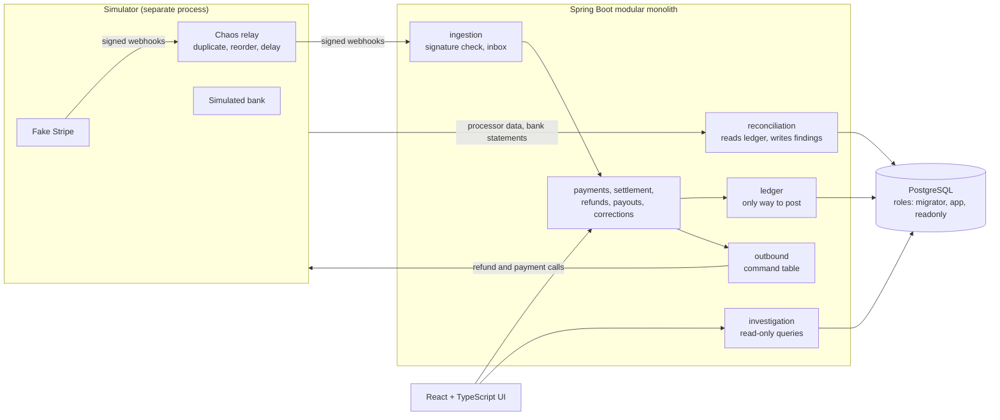

# Architecture overview

This is the English entry point. The design documents and ADRs are in Chinese; each section below links to the source of truth. If this page and those documents disagree, they win.

## The problem

A small platform collects card payments for one merchant in CAD. A processor (a Stripe-compatible simulator, or a real Stripe test-mode account) reports captures, payouts and refunds by webhook. The platform has to keep correct books even though webhooks repeat and arrive out of order, responses get lost, and three parties can disagree about what happened. No real money is involved.

## System

The arrows show the main paths, not every module dependency. Statement files reach the app through its import API, and the simulator's data is stored in its own PostgreSQL schemas. Spring Modulith's `verify()` test fails the build if a module crosses its declared boundary. The app never reads the simulator's schemas, and the simulator shares no Java code with the app ([ADR-0013](adr/0013-modular-monolith-and-simulators.md)).

Stripe test mode can replace the fake processor, as a long-running local stack; CI replays recorded, redacted fixtures instead ([Stripe integration](design/stripe-integration.md)).

## The money model

Amounts are integer cents. Every entry balances and is sealed after commit. Worked examples with hand-calculated balances are in the [money model](design/money-model.md).

| Event | Debit | Credit |
|---|---|---|
| Payment captured | 1101 processor receivable | 2101 merchant pending |
| Batch settled, net N, fee F, gross G | 1102 settlement in transit (N), 2101 (F) | 1101 (N+F) |
| Same entry: merchant funds released | 2101 (G−F) | 2102 merchant available (G−F) |
| Bank deposit seen on statement | 1103 bank cash | 1102 |
| Refund accepted | 2102 | 2103 refund payable |
| Refund executed by processor | 2103 | 1101 |
| Payout reserved | 2102 | 2104 payout in transit |
| Payout debit seen on statement | 2104 | 1103 |

Cash moves only on bank statement evidence, never on an API response.

## How correctness is enforced

| Rule | Where it is enforced | Source |
|---|---|---|
| Entries are append-only | Database triggers and role grants, checked by tests that connect as `app` and `readonly` | [ADR-0003](adr/0003-sealed-entries-and-db-invariants.md), [ADR-0014](adr/0014-db-roles-and-threat-boundary.md) |
| Concurrent refunds and payouts cannot overspend | A single funds-lock row, then business-row and account locks in a fixed order, tested with barriers and controlled interleavings | [ADR-0004](adr/0004-concurrency-and-lock-order.md) |
| Duplicates have no second effect | Three separate layers: event ID, API idempotency key, business reference | [ADR-0009](adr/0009-three-layer-idempotency.md), [ADR-0007](adr/0007-webhook-inbox.md) |
| A lost response never releases funds | A payout stays `UNKNOWN` and reserved until a query or the bank statement settles it | [ADR-0006](adr/0006-payout-unknown-outcome.md), [ADR-0008](adr/0008-outbound-command-table.md) |
| Mistakes are corrected, not edited | Reversal plus restatement, limited to named correction types | [ADR-0011](adr/0011-restricted-correction.md) |
| Reconciliation is independent | Compares the ledger with processor data and bank statements, and only writes findings | [ADR-0010](adr/0010-reconciliation-matching.md) |
| Random event sequences hold invariants | jqwik stateful tests against a separate reference model that reuses no business code | [ADR-0018](adr/0018-property-based-invariant-testing.md) |

## Trade-offs

| Choice | Alternative | Why |
|---|---|---|
| Modular monolith plus PostgreSQL | Microservices, Kafka | Money writes need one transaction. Nothing here needs a broker yet, and the failure modes are easier to test ([ADR-0013](adr/0013-modular-monolith-and-simulators.md)) |
| A narrow outbound command table | Spring Modulith event publication registry | Refund and payout commands need query-before-resend and explicit unknown states ([ADR-0008](adr/0008-outbound-command-table.md)) |
| A settlement-in-transit account | Book cash when the processor reports a payout | The processor saying it paid is not the bank receiving it ([ADR-0001](adr/0001-settlement-in-transit-and-batch-net.md)) |

## Around the core

- **Investigation agent** (`agent/`, standard-library Python, separate process): investigates one reconciliation issue through GET-only tools and cites the records it used. It has no write path. In the workbench a person must adopt its conclusion, and adopting only pre-fills a form for the existing write endpoints. The same tools are offered over MCP ([ADR-0019](adr/0019-investigation-agent-and-evaluation.md), [ADR-0020](adr/0020-agent-in-workbench-and-mcp.md)).
- **Observability**: structured JSON logs with correlation ids, Prometheus metrics on a loopback management port, and alert rules delivered through Alertmanager to a local receiver ([ADR-0021](adr/0021-observability.md), [ADR-0022](adr/0022-alert-delivery-and-tracing-plan.md)). Business gauges are queried through the `readonly` role.

## Where to read next

- [Acceptance criteria](acceptance-criteria.md): the definition of done. Test method names carry AC numbers, so `git grep ac_3_2` finds the test.
- [Phases](design/phases.md), [state machines](design/state-machines.md), [contracts](design/contracts.md), [data dictionary](design/data-dictionary.md), [Stripe integration](design/stripe-integration.md).
- [All ADRs](adr/) and [acceptance checklists by phase](handoff/).
